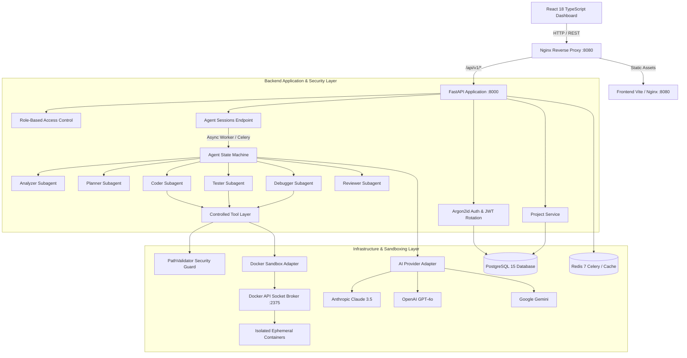
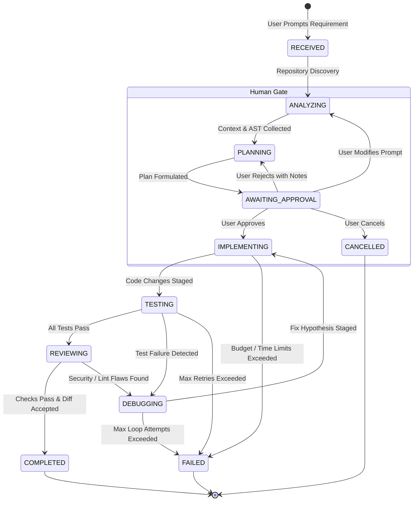

# Autonomous AI Coding Agent Platform

<div align="center">


**An enterprise-grade, end-to-end autonomous software engineering platform capable of decomposing complex software requirements, generating plans, safely modifying code in isolated Docker sandboxes, executing test suites, performing root-cause debugging, reviewing diffs, and committing to Git with human-in-the-loop oversight.**

[Features](#-key-features) • [Architecture](#-system-architecture) • [Subagents](#-specialized-subagents) • [Security & Sandbox](#-security--sandbox-containment) • [Quick Start](#-quick-start-guide) • [API Reference](#-api-endpoints) • [Testing](#-testing-strategy)

</div>

---

## 📖 Executive Summary

The **Autonomous AI Coding Agent Platform** is an enterprise-ready autonomous development platform (similar to Devin / SWE-bench agents). The platform ingests natural-language feature requests, bug reports, and refactoring directives, parses existing repository structures, formulates multi-phase implementation plans, executes code edits via a strictly verified 7-step modification protocol, runs automated test suites inside ephemeral, sandboxed Docker containers, and iterates through automated debugging loops until verification succeeds.

It provides defense-in-depth isolation, human-in-the-loop gates for high-risk actions, pluggable multi-LLM orchestration (Anthropic Claude 3.5 Sonnet, OpenAI GPT-4o, Google Gemini), full Git VCS isolation, and a real-time reactive glassmorphic web dashboard.

---

## 🚀 Key Features

- **8-Stage Autonomous State Machine:** Deterministic lifecycle transition tracking: `RECEIVED` ➔ `ANALYZING` ➔ `PLANNING` ➔ `AWAITING_APPROVAL` ➔ `IMPLEMENTING` ➔ `TESTING` ➔ `DEBUGGING` ➔ `REVIEWING` ➔ `COMPLETED` / `FAILED`.
- **Specialized Multi-Subagent Decomposition:**
  - 🔍 **Analyzer Subagent:** Discovers workspace context, parses ASTs, identifies file dependencies, and locates relevant codebases.
  - 📋 **Planner Subagent:** Breaks complex goals into verifiable milestones, file targets, and regression test strategies.
  - 💻 **Coder Subagent:** Executes precision file modifications adhering to a rigid 7-step safe editing protocol.
  - 🧪 **Tester Subagent:** Auto-detects test runners (pytest, npm, cargo, go), triggers isolated test runs, and parses failure logs.
  - 🛠️ **Debugger Subagent:** Performs automated root-cause analysis on stack traces, formulates hypotheses, and implements targeted fixes.
  - 🛡️ **Reviewer Subagent:** Automated static analysis, security vulnerability scanning, secrets leak detection, and style checks.
- **Strict Docker Sandbox Isolation:** Ephemeral containers with memory caps (512MB), CPU quotas (2.0 cores), PID limits (100), read-only root filesystems, network egress containment, and a filtered `sandbox-broker` proxy preventing raw host socket exposure.
- **Path Traversal & Secrets Defense (`PathValidator`):** Rejects directory traversal attempts (`../`), blocks system directories (`/etc`, `C:\Windows`), and forbids access to sensitive keys (`.env`, `.pem`, `id_rsa`).
- **Pluggable AI Providers:** Unified `AIProviderInterface` permitting instant switching between Anthropic (Claude 3.5 Sonnet), OpenAI (GPT-4o), and Google Gemini.
- **Human-in-the-Loop Approval Gate:** Configurable execution modes (`PLAN_ONLY`, `APPROVAL_REQUIRED`, `AUTONOMOUS`). Prompts can pause before execution to let developers review, approve, modify, or reject plans.
- **Sandboxed Git & VCS Integration:** Sandboxed Git provider tracking branches, staging changes, generating diffs, validating protected branches (`main`, `master`), and maintaining signed commit audit trails.
- **Real-Time Observability & Metrics:** Exposes 12 production-grade Prometheus metrics and JSON telemetry (token consumption, execution latencies, tool call budgets, failure distributions, estimated USD costs).
- **Modern Glassmorphic React UI:** Built with React 18, TypeScript, Vite, Lucide Icons, and custom CSS featuring live step badges, execution metrics, Git diff viewers, file browsers, and telemetry dashboards.

---

## 🏗️ System Architecture



---

## 🔄 Agent State Machine Lifecycle



---

## 🤖 Specialized Subagents

| Subagent | Role & Objective | Primary Tools Used | Output Artifact |
| :--- | :--- | :--- | :--- |
| **Analyzer** | Scans directory hierarchies, parses project structures, reads configs (`package.json`, `pyproject.toml`, `Cargo.toml`), identifies entrypoints and AST relationships. | `read_file`, `list_directory`, `search_code`, `ast_grep` | Architectural context summary, targeted files list |
| **Planner** | Decomposes high-level requirements into phased implementation steps, defines validation criteria, determines affected files, and flags high-risk operations. | Internal reasoning, prompt templates | Phased structured implementation plan |
| **Coder** | Implements planned changes following a rigid 7-step safe editing protocol (Read ➔ Validate ➔ Backup ➔ Edit ➔ Verify Syntax ➔ Lint ➔ Stage). | `read_file`, `write_file`, `edit_file_block`, `delete_file` | Concrete code edits & diff patches |
| **Tester** | Discovers test suites, provisions isolated test executions in the sandbox, monitors exit codes, captures stdout/stderr, and parses stack traces. | `run_command`, `execute_tests` | Structured test run summary (passed, failed, skipped, errors) |
| **Debugger** | Ingests failing test outputs and stack traces, isolates root causes, queries relevant code lines, develops fixes, and routes back to the Coder. | `read_file`, `search_code`, `run_command` | Root cause analysis & remedial fix directives |
| **Reviewer** | Performs independent static analysis, evaluates code quality, verifies security posture (OWASP Top 10, CWE-79, CWE-89), detects hardcoded secrets, and validates style. | `read_file`, `git_diff`, `run_linter` | Review score, findings list, and approval recommendation |

---

## 🛡️ Security & Sandbox Containment

The platform adheres to a zero-trust model where all code generated by the LLM is treated as untrusted:

### 1. Ephemeral Docker Sandboxes
- Every agent run operates in an ephemeral Docker container (`DockerSandboxAdapter`).
- Containers are isolated on a dedicated bridge network with external internet access restricted by default.
- Strict resource quotas enforced at the Linux cgroup level:
  - **Memory Limit:** 512 MB maximum
  - **CPU Quota:** 2.0 cores
  - **Process Limit (PIDs):** Maximum 100 concurrent processes (prevents fork bombs)
  - **Output Truncation:** Maximum 1 MB stdout/stderr buffer to prevent memory exhaustion
  - **Execution Timeout:** Hard timeout of 120 seconds per command

### 2. Docker Socket Broker (`sandbox-broker`)
The application container **never mounts the raw Docker socket (`/var/run/docker.sock`)**. A dedicated socket proxy (`sandbox-broker`) intercepts all Docker API calls, allowing only container lifecycle operations (`create`, `start`, `kill`, `exec`, `remove`) while blocking privileged containers, host bind-mounts outside the scratch workspace, and daemon reconfiguration.

### 3. File System & Path Security (`PathValidator`)
- Enforces strict canonical path containment within the assigned project sandbox directory.
- Blocks directory traversal attacks (`../`, `..\\`, null bytes).
- Completely forbids operations targeting system paths (`/bin`, `/sbin`, `/etc`, `/usr`, `C:\Windows`, `C:\Program Files`).
- Prevents reading, writing, or exposing sensitive credentials (`.env`, `.git/config`, `id_rsa`, `*.pem`, `*.key`, `.aws/credentials`).

### 4. Git Security & Protected Branches
- Protects primary repository branches (`main`, `master`, `production`, `release/*`) against direct writes or forced pushes.
- Mandates branch creation (e.g., `agent/feature-xyz`) and pull request workflows.
- Generates cryptographic commit signatures and detailed audit records for every Git action.

---

## 💻 Tech Stack

### Backend
- **Framework:** [FastAPI](https://fastapi.tiangolo.com/) (Python 3.11+) ASGI
- **Database ORM:** [SQLAlchemy 2.0](https://www.sqlalchemy.org/) (AsyncIO with `asyncpg`)
- **Database:** [PostgreSQL 15](https://www.postgresql.org/) with [Alembic](https://alembic.sqlalchemy.org/) migrations
- **Asynchronous Task Queue:** [Celery 5.3](https://docs.celeryq.dev/) with [Redis 7](https://redis.io/)
- **Authentication:** Argon2id password hashing, JWT Access & Refresh Token rotation
- **Telemetry & Logging:** [Structlog](https://www.structlog.org/) JSON logging, [Prometheus Client](https://github.com/prometheus/client_python), OpenTelemetry SDK
- **AI Integrations:** `anthropic>=0.20.0`, `openai>=1.14.0`, `google-genai>=0.1.0`

### Frontend
- **Framework:** [React 18.2](https://react.dev/) with [TypeScript 5.2](https://www.typescriptlang.org/)
- **Build Tool:** [Vite 5](https://vitejs.dev/)
- **State Management:** [Zustand](https://github.com/pmndrs/zustand)
- **Icons & Styling:** [Lucide React](https://lucide.dev/), Custom Glassmorphic Fluid Design (`index.css`)
- **HTTP Client:** [Axios](https://axios-http.com/)

### Infrastructure & Orchestration
- **Containerization:** Docker & Docker Compose
- **Reverse Proxy:** Nginx with SSL/TLS termination, rate limiting, and HTTP security headers

---

## 📁 Repository Structure

```
├── .env.example                     # Environment configuration template
├── docker-compose.yml               # Local development multi-container orchestration
├── backend/                         # FastAPI Application & AI Engine
│   ├── Dockerfile                   # Multi-stage production Python container
│   ├── alembic/                     # Database migration scripts
│   ├── pyproject.toml               # Poetry/pip tool configurations (ruff, mypy, pytest)
│   ├── requirements.txt             # Locked production dependencies
│   ├── requirements-dev.txt         # Dev & test dependencies (pytest, vcrpy, pip-tools)
│   ├── app/
│   │   ├── api/                     # HTTP Endpoints, routers, and middlewares
│   │   │   ├── middlewares/         # Observability, rate-limiting, error handling
│   │   │   └── v1/                  # API v1 endpoints (auth, projects, sessions, git, metrics)
│   │   ├── application/             # Core business orchestrators & subagents
│   │   │   └── agent/               # State machine, safeguards, memory manager
│   │   │       └── subagents/       # Analyzer, Planner, Coder, Tester, Debugger, Reviewer
│   │   ├── core/                    # App configuration, security primitives, logging, metrics
│   │   ├── domain/                  # Pure domain entities, value objects, and interfaces
│   │   │   ├── entities/            # Agent, Session, Step, Tool, Git, User, Project models
│   │   │   └── interfaces/          # AIProvider, Sandbox, GitProvider abstractions
│   │   ├── infrastructure/          # External adapters & system implementations
│   │   │   ├── ai_providers/        # Anthropic, OpenAI, and Gemini SDK integrations
│   │   │   ├── db/                  # SQLAlchemy models and session engine
│   │   │   ├── sandbox/             # Docker sandbox adapter & cgroups containment
│   │   │   ├── tools/               # ControlledToolLayer, PathValidator, File & Shell tools
│   │   │   └── vcs/                 # LocalGitProvider implementation
│   │   ├── schemas/                 # Pydantic v2 request/response validation schemas
│   │   └── services/                # AuthService, ProjectService, BruteForceService
│   └── tests/                       # 565 Pytest test suite
│       ├── unit/                    # Fast isolated business logic tests
│       ├── integration/             # Real component wiring & Git VCS integration
│       ├── api/                     # FastAPI endpoint contract tests
│       ├── database/                # SQLAlchemy models, cascades, and constraints
│       ├── agent/                   # State machine transitions and human approval
│       ├── tools/                   # ControlledToolLayer security and path checks
│       └── sandbox/                 # Container isolation and containment tests
├── frontend/                        # React 18 TypeScript Single-Page Application
│   ├── Dockerfile                   # Nginx static deployment container
│   ├── package.json                 # Node dependencies and scripts
│   ├── vite.config.ts               # Vite configuration
│   └── src/
│       ├── components/
│       │   ├── agent/               # Live metrics, Git diff, Plan, Test result viewers
│       │   └── common/              # Header, Sidebar, ErrorBoundary, Modal
│       ├── pages/                   # Dashboard, Projects, Session Workspace, Settings
│       ├── store/                   # Zustand stores (navigation, session, auth)
│       └── types/                   # TypeScript interfaces and API schemas
├── deploy/                          # Production deployment assets & Compose configurations
└── docs/                            # Comprehensive architectural, security, and CI/CD docs
```

---

## ⚡ Quick Start Guide

### Prerequisites
- [Docker](https://docs.docker.com/get-docker/) (v24.0+) & [Docker Compose](https://docs.docker.com/compose/) (v2.20+)
- Python 3.11+ (if running without Docker)
- Node.js 18+ & npm 9+ (if running frontend without Docker)
- At least one AI Provider API Key:
  - Anthropic (`ANTHROPIC_API_KEY`)
  - OpenAI (`OPENAI_API_KEY`)
  - Google Gemini (`GEMINI_API_KEY`)

---

### Option 1: Running with Docker Compose (Recommended)

1. **Clone the repository:**
   ```bash
   git clone https://github.com/your-org/autonomous-coding-agent.git
   cd autonomous-coding-agent
   ```

2. **Configure environment variables:**
   ```bash
   # On Linux / macOS:
   cp .env.example .env

   # On Windows PowerShell:
   Copy-Item .env.example .env
   ```
   *Edit `.env` and configure your `SECRET_KEY`, `POSTGRES_PASSWORD`, and at least one LLM key (e.g. `ANTHROPIC_API_KEY`).*

3. **Start the complete stack:**
   ```bash
   docker compose up --build
   ```

4. **Access the application:**
   - **Frontend Dashboard:** [http://localhost:8080](http://localhost:8080)
   - **Backend OpenAPI Docs:** [http://localhost:8080/api/v1/docs](http://localhost:8080/api/v1/docs)
   - **Prometheus Metrics:** [http://localhost:8080/api/v1/metrics](http://localhost:8080/api/v1/metrics)

---

### Option 2: Local Manual Setup (Development Mode)

#### 1. Backend Setup

```bash
cd backend

# Create and activate virtual environment
python -m venv .venv

# On Linux / macOS:
source .venv/bin/activate
# On Windows PowerShell:
.venv\Scripts\Activate.ps1

# Install dependencies
pip install -r requirements.txt
pip install -r requirements-dev.txt

# Run database migrations
alembic upgrade head

# Start FastAPI server with hot reload
uvicorn app.main:app --host 0.0.0.0 --port 8000 --reload
```

#### 2. Frontend Setup

```bash
cd frontend

# Install Node dependencies
npm install

# Run Vite dev server with hot module replacement
npm run dev
```
*Frontend runs at `http://localhost:5173` and proxies `/api` calls to the backend on `http://localhost:8000`.*

---

## ⚙️ Configuration & Environment Variables

| Variable | Description | Default | Required in Production |
| :--- | :--- | :--- | :---: |
| `ENVIRONMENT` | Target runtime environment (`development`, `test`, `production`) | `development` | Yes |
| `DEBUG` | Enable debug logs & reload (must be `false` in production) | `true` | Yes |
| `SECRET_KEY` | Cryptographic key used to sign JWT tokens (≥ 32 characters) | - | **Yes (Secret)** |
| `ALLOWED_ORIGINS` | JSON list of allowed CORS origins | `["http://localhost:8080"]` | Yes |
| `POSTGRES_SERVER` | PostgreSQL hostname / Docker service name | `postgres` | Yes |
| `POSTGRES_PORT` | PostgreSQL port | `5432` | No |
| `POSTGRES_DB` | PostgreSQL database name | `agent_platform` | Yes |
| `POSTGRES_USER` | PostgreSQL username | `agent` | Yes |
| `POSTGRES_PASSWORD` | PostgreSQL password | - | **Yes (Secret)** |
| `REDIS_HOST` | Redis host for Celery worker & caching | `redis` | Yes |
| `REDIS_PORT` | Redis port | `6379` | No |
| `DEFAULT_AI_PROVIDER`| Primary LLM engine (`anthropic`, `openai`, `gemini`) | `anthropic` | No |
| `DEFAULT_MODEL_NAME` | Default model identifier | `claude-3-5-sonnet-20241022`| No |
| `ANTHROPIC_API_KEY`  | Anthropic Claude API key | - | Optional* |
| `OPENAI_API_KEY`     | OpenAI GPT API key | - | Optional* |
| `GEMINI_API_KEY`     | Google Gemini API key | - | Optional* |
| `SANDBOX_RUNTIME`    | Sandbox execution engine (`docker` or `in_process`) | `docker` | Yes |
| `SANDBOX_MAX_MEMORY_MB` | Memory ceiling per agent execution sandbox | `512` | No |
| `SANDBOX_MAX_CPUS`   | CPU core quota per container | `2.0` | No |
| `SANDBOX_MAX_PIDS`   | Max concurrent processes inside sandbox | `100` | No |
| `MAX_AGENT_ITERATIONS`| Maximum loop iterations per coding task | `20` | No |

*\* At least one AI API key is required to execute coding sessions.*

---

## 📡 API Endpoints

The API is fully documented via interactive Swagger UI at `/api/v1/docs`.

### Authentication (`/api/v1/auth`)
- `POST /api/v1/auth/register` — Register new user account.
- `POST /api/v1/auth/login` — Authenticate credentials, receive JWT access & refresh tokens.
- `POST /api/v1/auth/refresh` — Rotate and exchange refresh token for a new access token.
- `POST /api/v1/auth/logout` — Revoke active refresh token.
- `GET /api/v1/auth/me` — Retrieve current authenticated user profile and roles.

### Projects (`/api/v1/projects`)
- `GET /api/v1/projects` — List projects accessible by current user.
- `POST /api/v1/projects` — Create a new project workspace.
- `GET /api/v1/projects/{id}` — Fetch project metadata and repositories.
- `DELETE /api/v1/projects/{id}` — Soft delete project and cleanup associated resources.

### Agent Sessions (`/api/v1/sessions`)
- `POST /api/v1/sessions` — Initialize and launch an autonomous coding session in background.
- `GET /api/v1/sessions/{id}` — Retrieve real-time session status, current state, and summary.
- `POST /api/v1/sessions/{id}/approve` — Approve plan and transition to `IMPLEMENTING`.
- `POST /api/v1/sessions/{id}/reject` — Reject plan with feedback notes; transitions back to `PLANNING`.
- `POST /api/v1/sessions/{id}/modify-requirements` — Update prompt requirements; transitions back to `ANALYZING`.
- `POST /api/v1/sessions/{id}/cancel` — Abort executing agent run and decommission sandbox.

### Git VCS Operations (`/api/v1/git`)
- `GET /api/v1/git/status` — Inspect active Git status, branch, staged and modified files.
- `GET /api/v1/git/diff` — Fetch unified git diff of unstaged/staged workspace changes.
- `POST /api/v1/git/branch` — Create or switch to an isolated feature branch.
- `POST /api/v1/git/commit` — Stage files and create a signed Git commit.
- `POST /api/v1/git/push` — Push feature branch to upstream remote repository.

### Observability & Metrics (`/api/v1/metrics`)
- `GET /api/v1/metrics` — Prometheus text exposition format scraper endpoint.
- `GET /api/v1/metrics/dashboard` — Aggregated JSON telemetry (token usage, task status, tool calls).
- `GET /api/v1/metrics/background-jobs` — Health and state of Celery daemon workers and subagents.

---

## 🧪 Testing Strategy

The repository includes a comprehensive 565-test automated testing suite that validates every layer without needing external network access, live model API keys, or Docker daemons in CI.

### Test Architecture Principles
- **No Mocking Everything:** Replaces only three boundary components:
  1. *Model Provider:* Substituted with deterministic `ScriptedAIProvider` / `FailingAIProvider`.
  2. *Docker Daemon:* Substituted with `InProcessSandbox` enforcing identical containment policies on real temp workspaces.
  3. *PostgreSQL:* Substituted with real SQLAlchemy async schema on file-backed SQLite.
- Everything else is executed for real: Pydantic validation, JWT cryptography, Argon2id hashing, `ControlledToolLayer`, `PathValidator`, Prompt templates, Subagents, and **real `git` binary operations**.

### Running the Tests

```bash
cd backend

# Run entire test suite
pytest tests -q

# Run with verbose output and test timing
pytest tests -v --durations=10

# Run specific category (e.g. Unit or Agent state machine)
pytest tests/unit/
pytest tests/agent/

# Run frontend tests
cd ../frontend
npm test
npm run test:coverage
```

---

## 🚢 CI/CD & Deployment

### GitHub Actions Workflows
- **Pull Request Pipeline (`.github/workflows/pr.yml`):**
  - Runs 11 parallel stages: dependency resolution, code formatting (`ruff format`, `prettier`), linting (`ruff`, `eslint`), static type checking (`mypy`, `tsc`), unit tests, integration tests with real Postgres/Redis services, security scans (`gitleaks`, `bandit`, `pip-audit`), container image builds, migration drift checks, frontend Vitest tests, and end-to-end integration tests.
- **Release Pipeline (`.github/workflows/release.yml`):**
  - Triggered on version tags; builds multi-architecture images, pushes to registry, executes non-breaking database migrations, and performs zero-downtime deployment verification.

---

## 🤝 Contributing

Contributions are welcome! Please follow these steps:

1. **Fork the repository** and create a descriptive feature branch:
   ```bash
   git checkout -b feature/your-feature-name
   ```
2. **Follow code formatting & linting standards:**
   - Backend: `ruff format` and `ruff check`
   - Frontend: `npm run format` and `npm run lint`
3. **Verify tests pass:**
   ```bash
   pytest tests
   npm run test
   ```
4. **Submit a Pull Request** with a detailed summary of your changes.

---

## 📄 License

This project is licensed under the [MIT License](LICENSE).

---

<div align="center">
  <sub>Built with ❤️ by the Autonomous AI Coding Agent Platform Engineering Team</sub>
</div>
