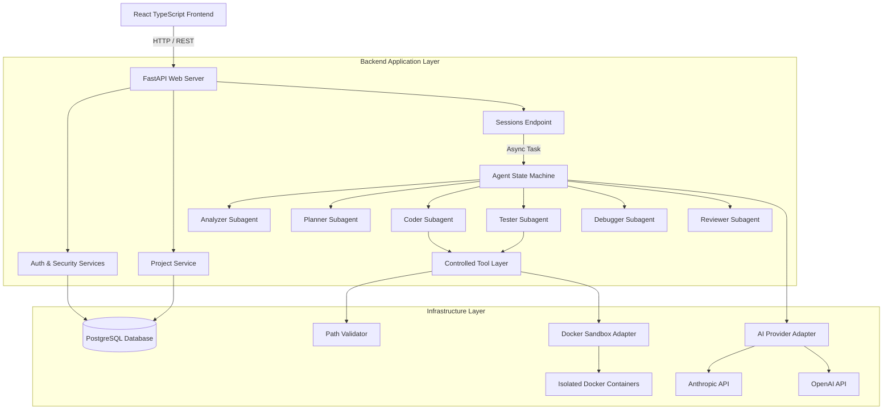

# Architecture Review

**Project:** Autonomous AI Coding Agent Platform (`sachin`)  

---

## 1. System Architecture Overview

---

## 2. Architectural Strengths

1. **Strict Separation of Concerns:** Domain entities (`app/domain/entities`) are completely decoupled from framework dependencies (FastAPI / SQLAlchemy).
2. **Pluggable AI Providers:** `AIProviderInterface` permits dynamic swapping between Anthropic, OpenAI, or custom LLM endpoints without altering agent loop logic.
3. **Multi-Stage Subagent Decomposition:** Complex coding tasks are split among dedicated subagents (Analyzer, Planner, Coder, Tester, Debugger, Reviewer).
4. **Isolated Execution Environment:** Untrusted code execution occurs inside ephemeral Docker containers with strict security constraints.

---

## 3. Architectural Weaknesses

1. **State Persistence Disconnect:** API endpoints use an in-memory dictionary rather than connecting `AgentStateMachine` to `AgentRepository` and PostgreSQL.
2. **Missing Real-Time Communication Layer:** Polling is used instead of WebSockets / Server-Sent Events (SSE) for streaming agent logs and execution steps.
3. **Single-Node Rate Limiter:** In-memory rate limiting impedes horizontal scaling.
