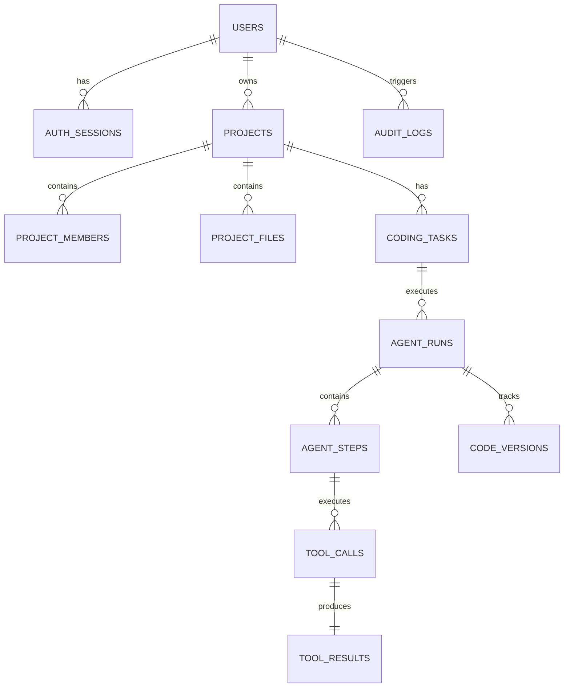

# Database Review

**Project:** Autonomous AI Coding Agent Platform (`sachin`)  
**Database Technology:** PostgreSQL 15, SQLAlchemy 2.0 (asyncio), Alembic  

---

## 1. Schema & Table Structure

The database schema is divided into three logical domains:

### Complete Schema Table List
1. `users` — Account records, email, Argon2 password hash, role, active/verified flags.
2. `auth_sessions` — Refresh token hashes, expiration, revocation timestamp, IP, User-Agent.
3. `password_reset_tokens` — SHA-256 hashed password reset tokens with 15-minute expiration.
4. `email_verification_tokens` — Hashed email verification tokens.
5. `api_keys` — Encrypted API key records.
6. `provider_credentials` — User-specific AI provider API keys.
7. `projects` — Project metadata, repository URL, default branch, language stack, owner foreign key.
8. `project_members` — Project team membership and project-level role assignment.
9. `project_files` — Tracked project file paths, hashes, sizes.
10. `coding_tasks` — High-level user prompt requirements and task status.
11. `agent_runs` — Agent execution run metadata, iteration count, token consumption, cost USD.
12. `agent_plans` — Generated Markdown plans and version history.
13. `agent_steps` — Individual state machine execution step logs.
14. `tool_calls` & `tool_results` — Tool invocations, inputs, stdout, stderr, exit codes, duration.
15. `code_versions` — Diffs, file hashes, commit SHAs for version control tracking.
16. `test_executions` — Total/passed/failed test metrics per step.
17. `error_logs` & `code_fixes` — Stack traces, error classification, root cause analysis, fix proposals.
18. `audit_logs` — System security audit trail.

---

## 2. Integrity, Foreign Keys & Cascading Audit

| Table | Foreign Key | Target Table | On Delete Rule | Index Status |
| :--- | :--- | :--- | :---: | :---: |
| `auth_sessions` | `user_id` | `users.id` | `CASCADE` | Indexed (`idx_auth_sessions_user_expires`) |
| `password_reset_tokens` | `user_id` | `users.id` | `CASCADE` | Unique Index on `token_hash` |
| `projects` | `owner_id` | `users.id` | `RESTRICT` | Primary Key & Unique Slug |
| `project_members` | `project_id` | `projects.id` | `CASCADE` | Unique Constraint `(project_id, user_id)` |
| `coding_tasks` | `project_id` | `projects.id` | `CASCADE` | Indexed (`idx_tasks_project_status`) |
| `agent_runs` | `task_id` | `coding_tasks.id` | `CASCADE` | Indexed (`idx_runs_task_status`) |
| `agent_steps` | `run_id` | `agent_runs.id` | `CASCADE` | Unique `(run_id, step_number)` |
| `tool_calls` | `step_id` | `agent_steps.id` | `CASCADE` | Primary Key |
| `tool_results` | `tool_call_id` | `tool_calls.id` | `CASCADE` | 1-to-1 Relationship |

---

## 3. Database Audit Findings

1. **Unused Schema Models in API Endpoint (P0):** All agent tables (`agent_runs`, `agent_steps`, `tool_calls`, `tool_results`) are fully defined in SQLAlchemy and tested, but `/api/v1/sessions` uses an in-memory dictionary `SESSIONS_DB` and fails to write agent run metrics to PostgreSQL.
2. **Missing Async Connection Pool Tuning (P2):** `app/infrastructure/db/session.py` initializes `create_async_engine` without specifying `pool_size`, `max_overflow`, or `pool_recycle`. Under high concurrent load, this can cause connection exhaustion.
