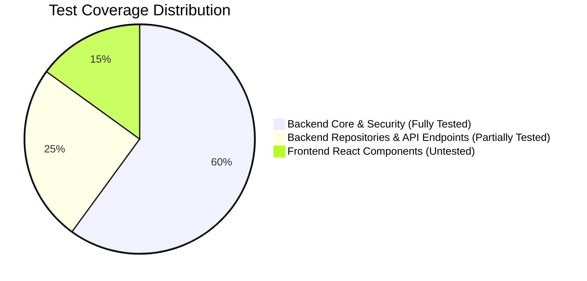

# Test Coverage Report

**Project:** Autonomous AI Coding Agent Platform (`sachin`)  

---

## 1. Test Suite Summary

- **Backend Framework:** Pytest + Pytest-Asyncio + Pytest-Cov
- **Total Backend Tests:** 53
- **Backend Pass Rate:** **100% (53 passed)**
- **Frontend Framework:** Vitest (configured in `package.json`)
- **Total Frontend Tests:** 0

---

## 2. Tested vs Untested Component Matrix

### Components with High Test Coverage
- `AgentStateMachine` (`tests/test_agent_state_machine.py`)
- `AuthService` & Token Security (`tests/test_auth.py`, `tests/test_auth_security.py`)
- `CodingAgent` & Safeguards (`tests/test_coding_agent.py`)
- `DebuggingAgent` (`tests/test_debugging_agent.py`)
- `TestingValidationAgent` (`tests/test_testing_agent.py`)
- `DockerSandboxAdapter` (`tests/test_sandbox.py`)
- `ControlledToolLayer` & `PathValidator` (`tests/test_secure_tool_execution.py`)

### Untested Critical Functionality
1. **`app/api/v1/endpoints/sessions.py`:** No API-level integration test exists for creating sessions via HTTP POST.
2. **Frontend `SessionWorkspace.tsx`:** Zero component unit tests exist.
3. **Database Repository Integration:** `AgentRepository` DB persistence methods lack dedicated integration tests against real PostgreSQL.
